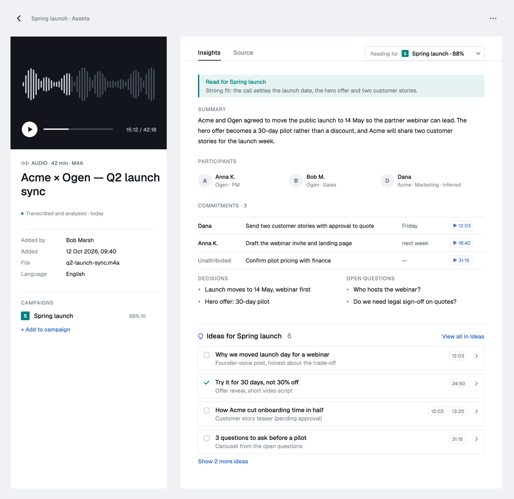
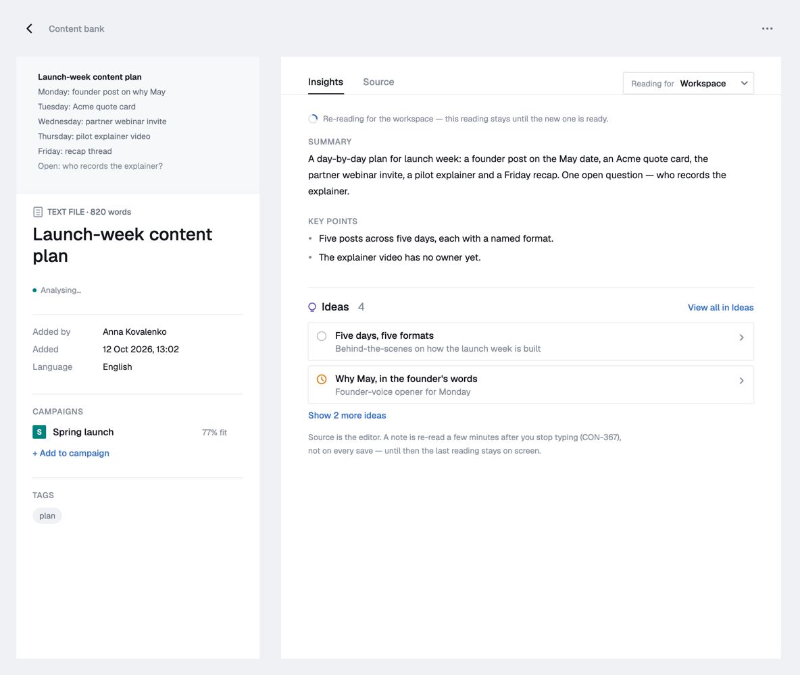
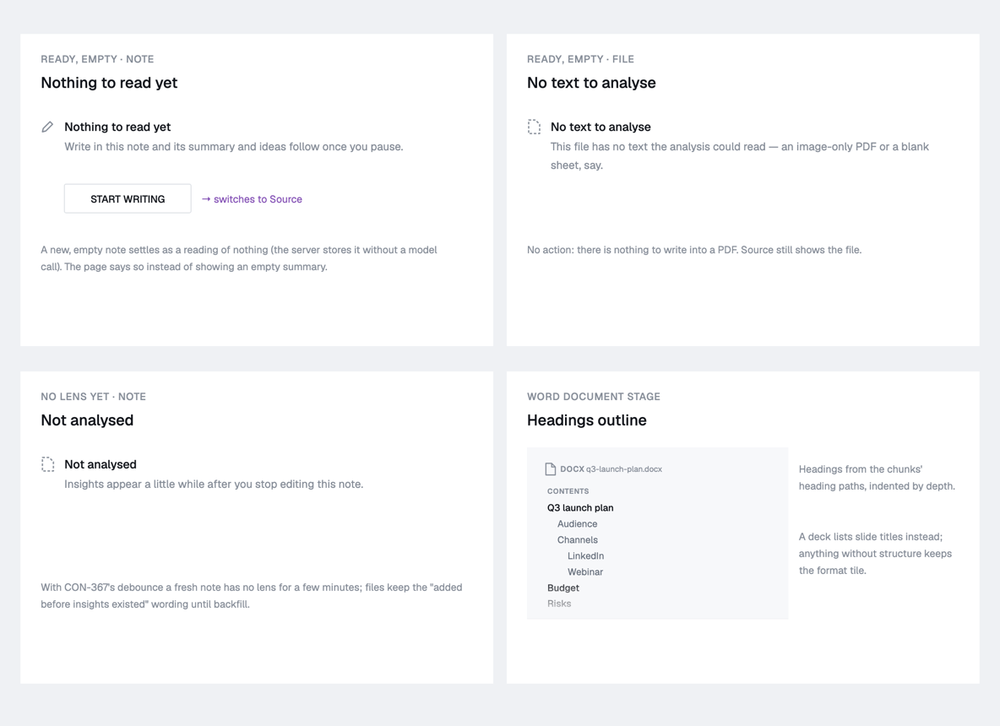
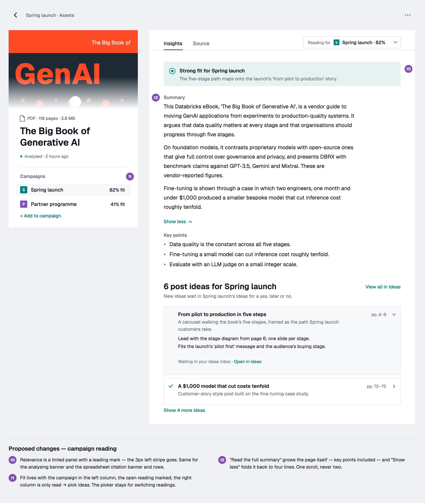
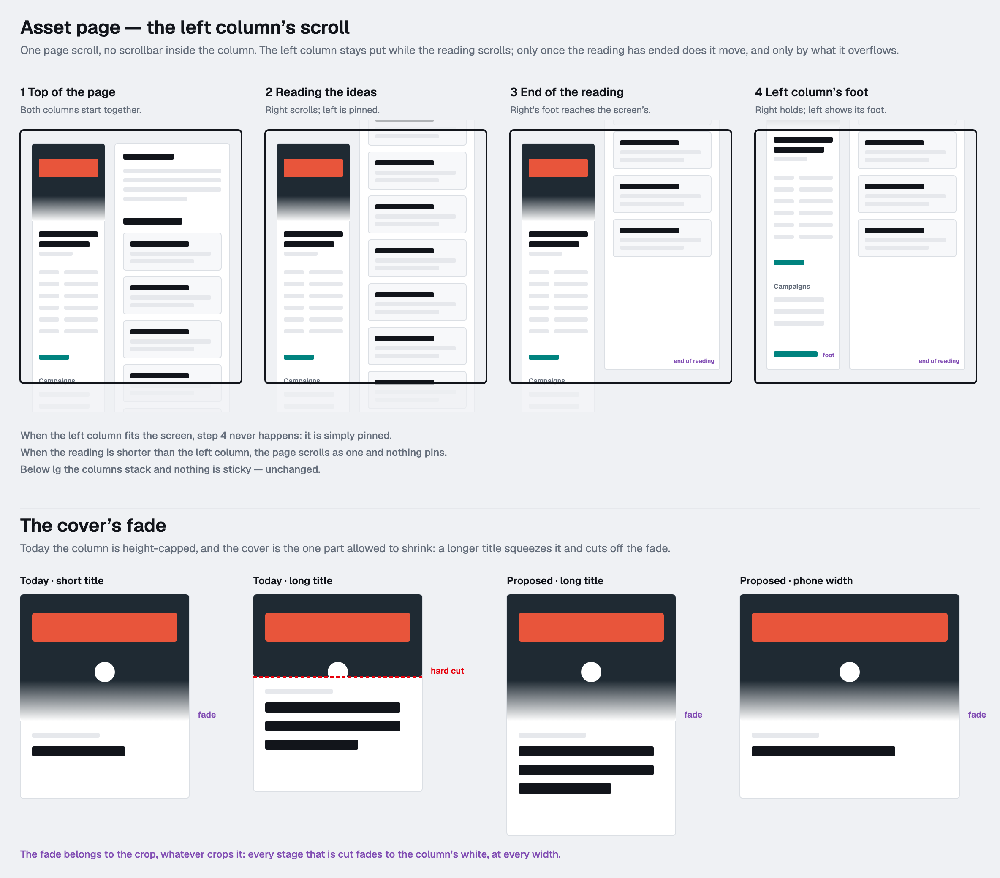

# The asset page — the reading, then the thing read (CON-366)

`/assets/:id` and `/campaigns/:id/assets/:assetId` are framed like the post
editor: under the global header, one line holding the asset's own 48px bar
over the **main column** and, level with it, the tab strip of a **side
column** (`page-primitives/SideColumn`, shared with `PostSideColumn`), so the
right rail stays the assistant's. Shipped unflagged. The main column is
cards and starts with the reading. It replaced the two columns of 2026-10
(what it is on the left, Insights | Source on the right) and, on 2026-11-23,
a first cut of this frame that put Ideas and Summary in side-column tabs —
the reason to open the page in 24rem, beside a document often three lines
long.

Code: `components/content/asset-page/` (`AssetPage`, `AssetBar`,
`AssetOverview`). Rules (pure, tested): `lib/assetAnalysis.ts`,
`lib/sheetChunks.ts`. Data: `hooks/useAssetAnalyses.ts` over
`GET /api/content-bank/assets/:id/analyses` (CON-364).

## The bar

`AssetBar`, the post's `PostBar` for a document, over the main column: ← back
to the assets list it came from (the campaign's or all), the title,
`SaveStatus`; the **lens picker**, since it governs every card under the
bar; a bordered ⋮ (read the page again, download as Markdown,
delete) and, last, **Download** for the original file. No black button — a
document saves as it is typed and has no status to move along.

## Main column

`ui/card` cards, one after another, starting with the reading:

- **Summary** — **Why it fits** (a campaign lens; the campaign is named in
  the picker above), the summary's **lead**
  (its first paragraph) with **Read the whole summary** for the rest, the key
  points, and a recording's meeting notes. Folded because it sits over the
  ideas: unfolded, a four-paragraph summary pushed them off the screen.
- **Ideas** — the piles, then every idea as the Ideas list's card
  (`ideas/IdeaRow` with `atSource`, below), then **Distill more ideas**.
- **Source**, titled by kind (Note, Document, Page, Spreadsheet, Image,
  Transcript) — the asset's **title** (edited here and nowhere else; a file
  name reads as words until renamed, `readableTitle`), then `assetScreen`'s
  screen: the editor, the extracted text, the
  image, a spreadsheet's table, a recording's transcript.

Until there is a reading, Summary and Ideas are **one short card** ("Summary
and ideas") with the state's notice and no skeletons, so the asset is on the
first screen. An image is never analysed and has the Source card alone. A
recording's player (the page's one `<audio>`) sits over every card, since
the chips in all of them seek it. The column scrolls on its own, with the
post's travel past the end.

The idea cards: the 20px fit ring, title, angle in two lines, the places it
cites and the three answers always on the card, best fit first (`byFit`), no
box column and nothing to select. Opened, a card holds the angle, the
rationale, **Why it scores N** (CON-385's `fit_breakdown`), **Reference** —
the page span, then the source chips, which play the recording or open the
sheet's rows in the Source card — the answer's record, and **Open in Ideas**.
Answers go through the asset's cache (`useAnswerIdea`), so the piles move
with them. A chip that opened a sheet's rows leaves **Back to the idea** in
the banner over them, since the sheet is a card further down.

## Side column

One tab for now, **Overview** (`AssetOverview`), in the post's strip so
there is room for the next: the asset's picture edge to edge where
it has one worth a look (a PDF's cover, a page's hero, a sheet's grid, a
Word file's headings or a deck's slide titles, else a format tile; never an
image or a note, which the Source card already shows), then two sections in
the post's two columns (`SettingList`), **every value led by its 16px mark**
and a value of several items one a line (`ValueLines`):

- **About** — kind line, status, **Campaigns** (each with its fit, the open
  reading's marked, then **Add to campaign**), added by, added, file or
  source, updated and images for a page, sheets, language, a Figma frame,
  **Tags**.
- **What it covers**, once there is a reading — topics (#), then mentions
  by kind (people, organisations, places, products, other), each with its
  kind's mark, twelve before "+N more"; a sheet's sheets. Context, not
  something to act on, so lines rather than pills.

There is no index of the cards ("On this page", cut 2026-11-23): three cards a
scroll apart, and the Ideas card counts its own piles.

- **Lens picker**: in the bar (`lensChoice`, shaped as a card's `choice`
  and drawn as one: the outline button with a chevron every card dropdown
  is) — "For  Spring launch · 64% fit". It lists the workspace reading and one per campaign with its fit, or
  "analysing…" while one is in flight, and keeps `?lens=` in the address. A
  campaign the asset joined before analysis existed has no row; it is listed
  and answers "not analysed". With no campaign at all there is nothing to
  pick, and the bar says "For your workspace" instead.
- **Piles** (CON-370): the ideas by verdict, labelled; `?verdict=` picks one,
  which is where the Assets list's verdict pill sends a click. An idea
  answered No is left out unless that pile is chosen; an answered card stays
  put until it is closed.
- **More ideas** (CON-398, unflagged): the ideas end in a ghost
  **Distill more ideas** (`AiChemistry02Icon`). It opens a modal — how many,
  3–10 in a segmented radio group, default 5, and an optional focus of up to
  300 characters, counted as the server counts it (trimmed, in code points).
  The run's news is a row at the foot of the list: in flight, nothing new
  (Try again reopens the form on the last ask), failed (Try again re-sends
  it), out of runs or not on the plan (See plans). A run that lands says
  nothing there — its ideas take their places by fit, each with a teal dot
  before the title, and a **N new** chip beside the piles narrows the list to
  them. Only a run this visit watched reports or marks anything. Runs live
  under the asset's key (`hooks/useIdeaDistill`), so
  `asset.ideas.distill.updated` moves them and their ideas together.
- **Type and colour**: readable grey text is `secondary-foreground` (gray-700,
  5.2:1 — gray-600 fails AA at 3.3:1), the tertiary grey is left to icons and
  markers. Highlights are tinted panels, never a coloured side stripe.
- **States** (in Ideas and Summary alike): reading / analysing (step tracker
  and skeleton), failed (Try again, optimistic), not in plan and monthly limit
  (See plans), no ideas, never analysed, analyses unreadable. A re-read keeps
  the old reading on screen until the new one lands. A reading that lands
  while the page is open says "Insights ready — N ideas added" at the top of
  Ideas for four seconds.

## Live updates

`asset.analysis.updated` on `entity:asset:<id>` refetches the asset subtree
and every Ideas list (`lib/eventRouting.ts`, `docs/events.md`). The analyses
poll every 15 s only while something is in flight. A lens that finishes while
the page is open says "Insights ready — N ideas added" for four seconds.
`asset.ideas.distill.updated` (CON-397) takes the same route; the runs poll
every 15 s only while one is in flight, and a poll that finds one settled
refetches the ideas itself.

## Shared controls

- One `<audio>` per page (`hooks/useAudioSeek`): the player heading the
  content column, driven by transcript lines, commitment chips and idea chips. Space plays, arrows step
  five seconds.
- `hooks/useSheetCite`: an idea's "Pipeline · rows 10–24" chip picks the sheet
  in the content column's table, fetches the pages that hold the rows and
  marks them.
- `?at=` (CON-388): the place an idea cites, gone to once — the recording
  plays from it, the sheet opens on its rows, a page or a labelled part is
  found in the content column's text, reading on page by page until it turns
  up.

## Spreadsheets

document-service writes per sheet one summary chunk (columns, data-row count,
sample rows) and row groups of `Label: value | …` lines under
`Sheet "X" rows 10-24` with a `cell_range` anchor. `lib/sheetChunks.ts` reads
that back. A row number shows only when it is certain (blank rows are skipped
but counted); a line that will not split is shown whole.

## Wireframes

Of the two-column page this frame replaced (2026-10) — the parts are the
same, their places are not.

The CON-369 design pass (from a design critique):

The left column's scroll and the stages' fades (CON-373):

The ideas list in the Assets list card's style, the fit explained and the idea
answered in place (CON-387):

Illustrative copy; the PRDs are CON-366, CON-369, CON-373 and CON-387 in
Linear.

