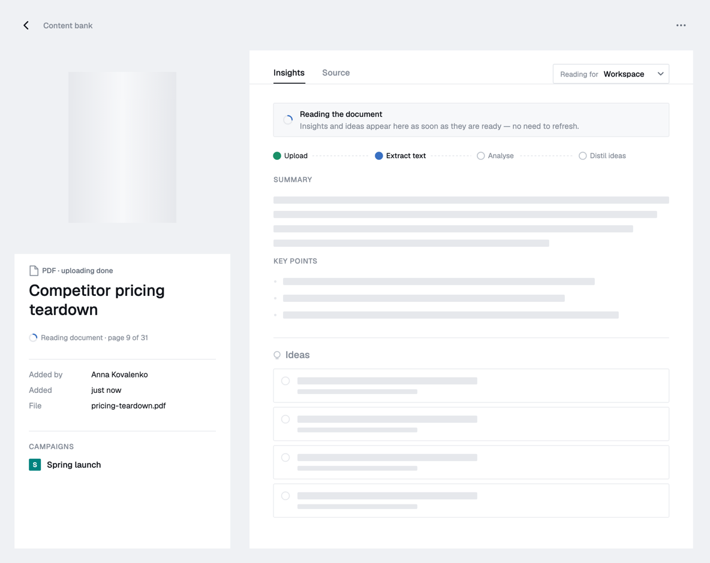
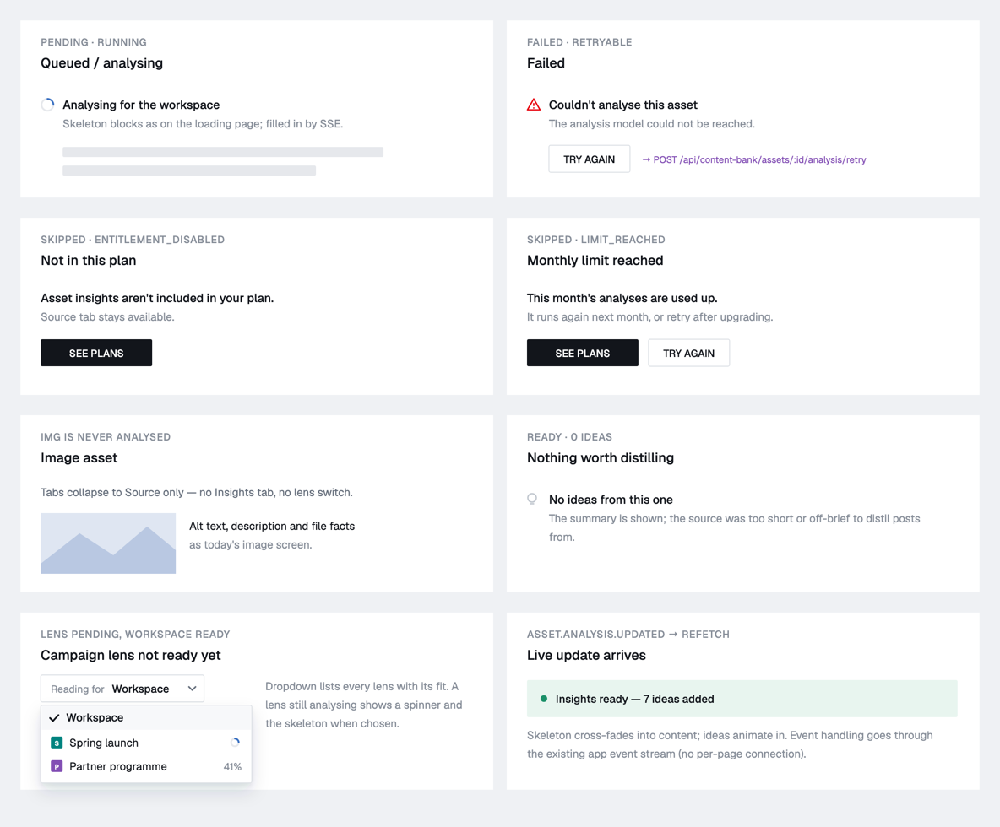
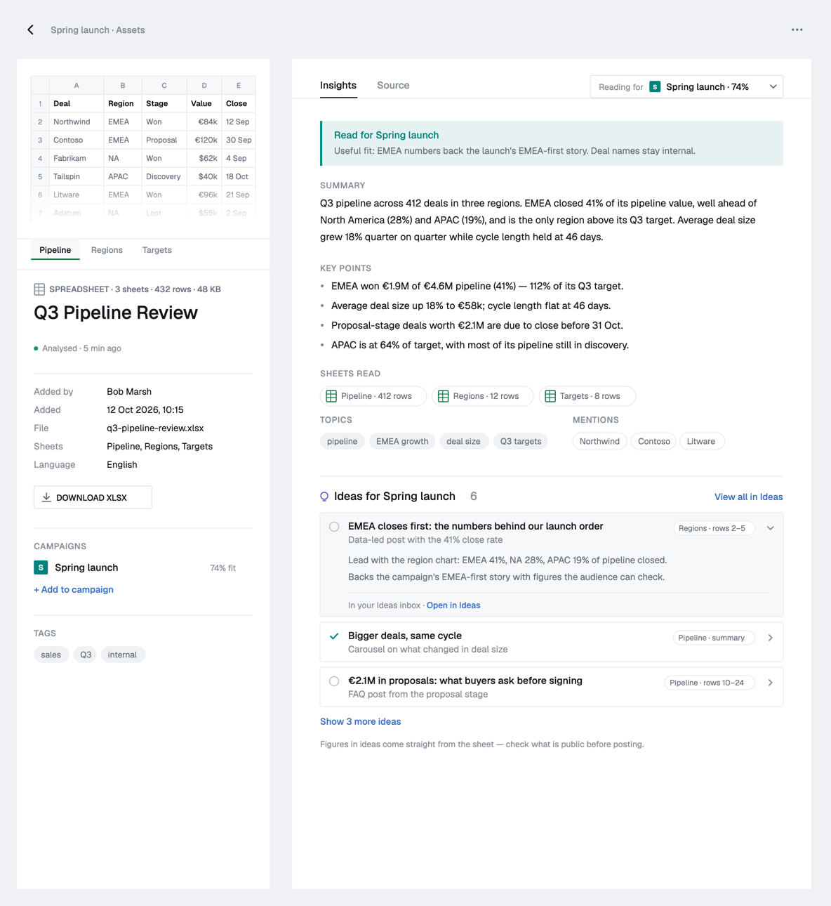
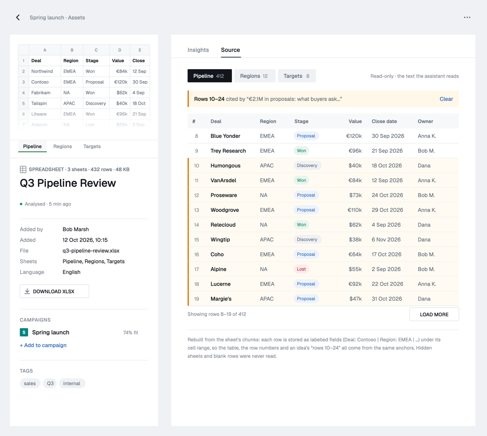
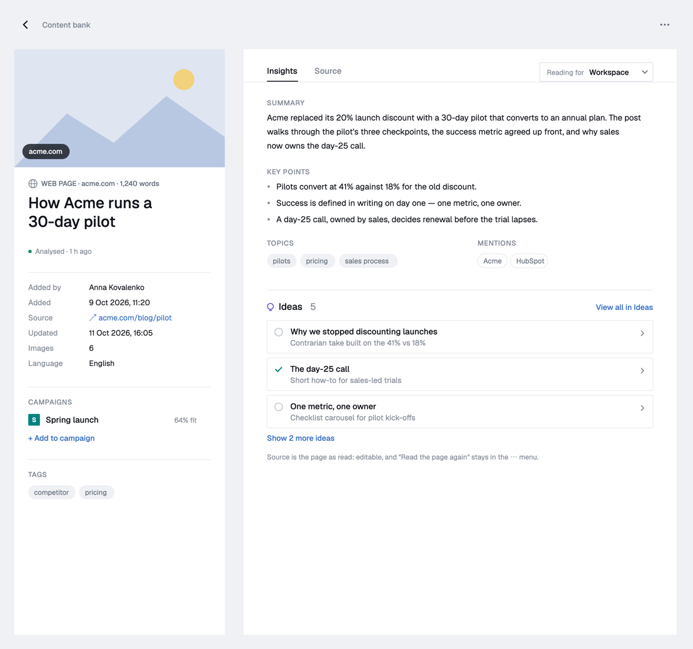
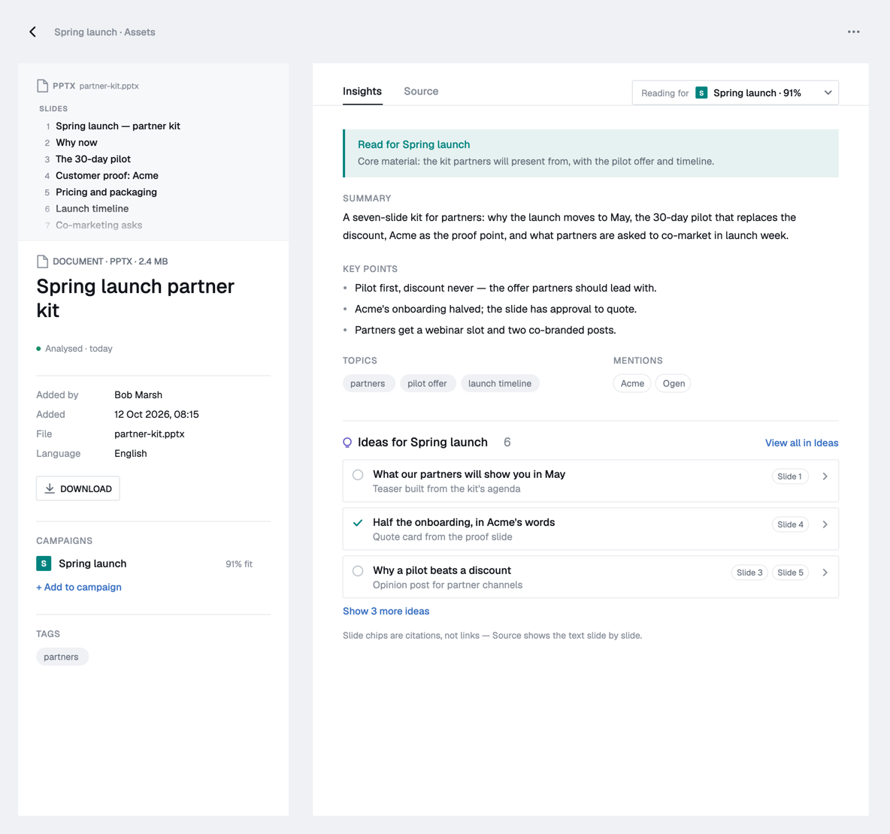
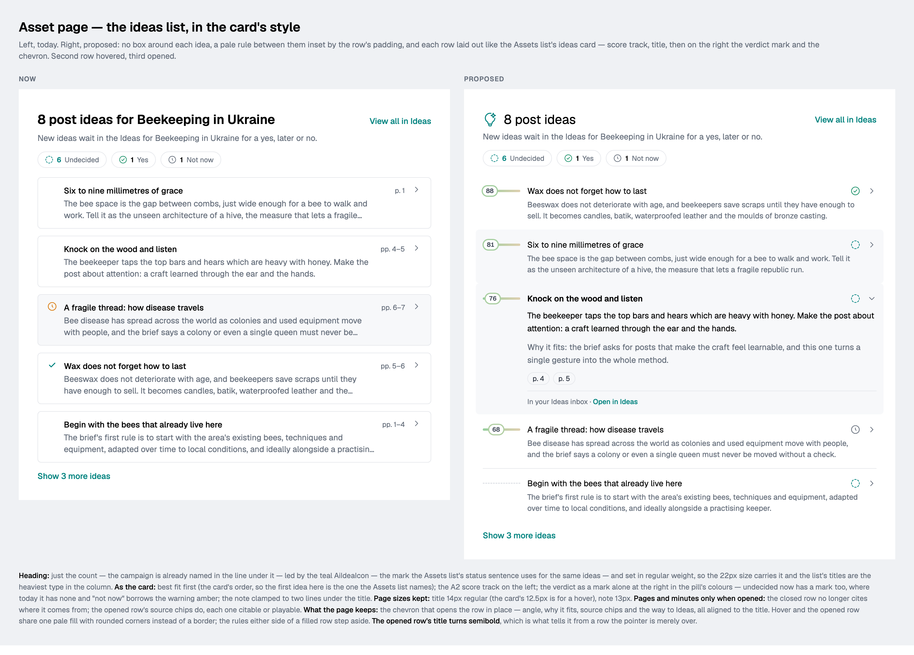
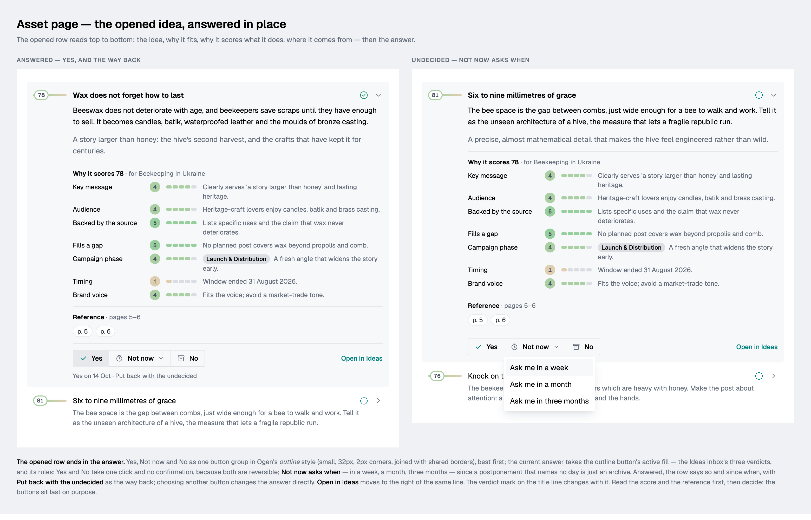
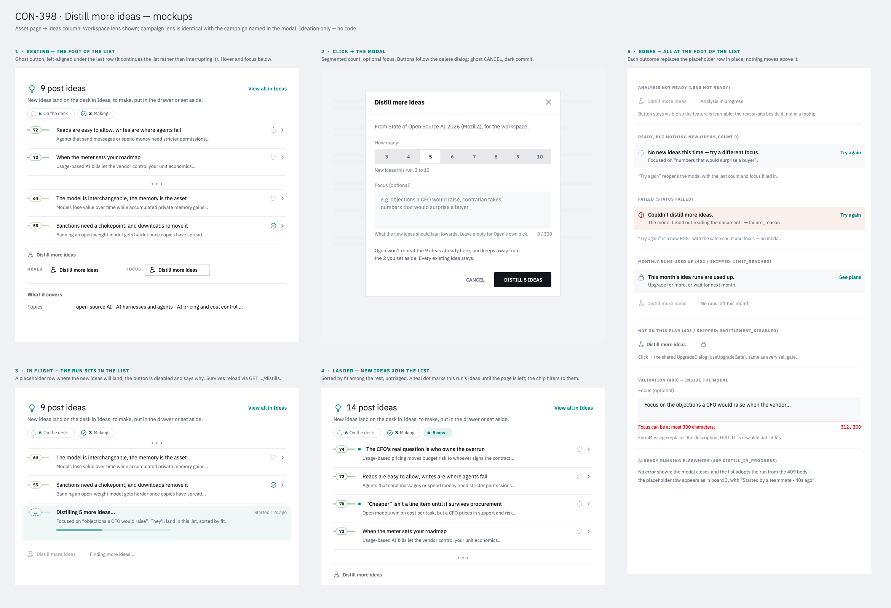

# The asset page — the post editor's frame, for a document (CON-366)

`/assets/:id` and `/campaigns/:id/assets/:assetId` are framed like the post
editor: the asset's own 48px bar over a **content column**, and a **side
column of tabs** beside it (`page-primitives/SideColumn`, shared with
`PostSideColumn`), so the right rail stays the assistant's. Shipped
unflagged. It replaced the two columns of 2026-10 (what it is on the left,
Insights | Source on the right, the left one sticky by `useStickyColumns`).

Code: `components/content/asset-page/` (`AssetPage`, `AssetBar`,
`AssetOverviewTab`). Rules (pure, tested): `lib/assetAnalysis.ts`,
`lib/sheetChunks.ts`, `lib/assetTabs.ts`. Data: `hooks/useAssetAnalyses.ts`
over `GET /api/content-bank/assets/:id/analyses` (CON-364).

## The bar

`AssetBar`, the post's `PostBar` for a document: ← back to the assets list it
came from (the campaign's or all), the title, `SaveStatus`; a bordered ⋮
(read the page again, download as Markdown, delete) and, last, **Download**
for the original file. No black button — a document saves as it is typed and
has no status to move along.

## Content column

The asset itself and nothing about it, on one white surface: the **title**
(edited here and nowhere else; a file name reads as words until renamed,
`readableTitle`), then `assetScreen`'s screen — the editor, the extracted
text, the image, a spreadsheet's table. A recording's player (the page's one
`<audio>`) heads it, over the transcript it drives. It scrolls on its own,
with the post's travel past the end.

## Side column

Three tabs, an icon over a one-word name, one remembered choice for every
asset (`settingsStore.assetTab`, Ideas the first time). An image is never
analysed and has the Overview alone.

- **Overview** — the asset's picture edge to edge where it has one worth a
  look (a PDF's cover, a page's hero, a sheet's grid, a Word file's headings
  or a deck's slide titles, else a format tile; never an image or a note,
  which the content column already shows); **About** in the post's two
  columns (kind line, status, added by, added, file or source, updated and
  images for a page, sheets, language, a Figma frame); one line each from
  Ideas ("6 ideas on the desk", or why there are none) and Summary (the
  lead, three lines), each opening its tab; **Campaigns** with their fit, the
  open reading's marked, and **Add to campaign**; **Tags**.
- **Ideas** — the lens line, then the piles, then every idea as the Ideas
  list's card (`ideas/IdeaRow` with `atSource`): the 20px fit ring, title,
  angle in two lines, the places it cites and the three answers always on the
  card, best fit first (`byFit`). There is no box column, nothing to select.
  Opened, a card holds the angle, the rationale, **Why it scores N**
  (CON-385's `fit_breakdown`, the reasons under their criteria at this width),
  **Reference** — the page span, then the source chips, which play the
  recording or open the sheet's rows in place — the answer's record, and
  **Open in Ideas**. Answers go through the asset's cache (`useAnswerIdea`),
  so the piles move with them. Then **Distill more ideas** (below).
- **Summary** — the lens line, the relevance panel (campaign lens), the whole
  summary as light Markdown with its key points (no fold: the tab is its
  own), then meeting notes for a recording and **What it covers**, a pale
  rule between each, laid out by the column's width.

- **Lens picker** (a dropdown, at the top of Ideas and Summary): the
  workspace reading and one per campaign, with fit, a spinner while one is in
  flight, and `?lens=` in the address. A campaign the asset joined before
  analysis existed has no row; it is listed and answers "not analysed". With
  no campaign at all there is nothing to pick, and the picker is a line of
  text instead.
- **Piles** (CON-370): the ideas by verdict, labelled; `?verdict=` picks one,
  which is where the Assets list's verdict pill sends a click. An idea
  answered No is left out unless that pile is chosen; an answered card stays
  put until it is closed.
- **More ideas** (CON-398, unflagged): the ideas end in a ghost
  **Distill more ideas** (`AiChemistry02Icon`). It opens a modal — how many,
  3–10 in a segmented radio group, default 5, and an optional focus of up to
  300 characters, counted as the server counts it (trimmed, in code points).
  The run's news is a row at the foot of the list: in flight, nothing new
  (Try again reopens the form on the last ask), failed (Try again re-sends
  it), out of runs or not on the plan (See plans). A run that lands says
  nothing there — its ideas take their places by fit, each with a teal dot
  before the title, and a **N new** chip beside the piles narrows the list to
  them. Only a run this visit watched reports or marks anything. Runs live
  under the asset's key (`hooks/useIdeaDistill`), so
  `asset.ideas.distill.updated` moves them and their ideas together.
- **Type and colour**: readable grey text is `secondary-foreground` (gray-700,
  5.2:1 — gray-600 fails AA at 3.3:1), the tertiary grey is left to icons and
  markers. Highlights are tinted panels, never a coloured side stripe.
- **States** (in Ideas and Summary alike): reading / analysing (step tracker
  and skeleton), failed (Try again, optimistic), not in plan and monthly limit
  (See plans), no ideas, never analysed, analyses unreadable. A re-read keeps
  the old reading on screen until the new one lands. A reading that lands
  while the page is open says "Insights ready — N ideas added" at the top of
  Ideas for four seconds.

## Live updates

`asset.analysis.updated` on `entity:asset:<id>` refetches the asset subtree
and every Ideas list (`lib/eventRouting.ts`, `docs/events.md`). The analyses
poll every 15 s only while something is in flight. A lens that finishes while
the page is open says "Insights ready — N ideas added" for four seconds.
`asset.ideas.distill.updated` (CON-397) takes the same route; the runs poll
every 15 s only while one is in flight, and a poll that finds one settled
refetches the ideas itself.

## Shared controls

- One `<audio>` per page (`hooks/useAudioSeek`): the player heading the
  content column, driven by transcript lines, commitment chips and idea chips. Space plays, arrows step
  five seconds.
- `hooks/useSheetCite`: an idea's "Pipeline · rows 10–24" chip picks the sheet
  in the content column's table, fetches the pages that hold the rows and
  marks them.
- `?at=` (CON-388): the place an idea cites, gone to once — the recording
  plays from it, the sheet opens on its rows, a page or a labelled part is
  found in the content column's text, reading on page by page until it turns
  up.

## Spreadsheets

document-service writes per sheet one summary chunk (columns, data-row count,
sample rows) and row groups of `Label: value | …` lines under
`Sheet "X" rows 10-24` with a `cell_range` anchor. `lib/sheetChunks.ts` reads
that back. A row number shows only when it is certain (blank rows are skipped
but counted); a line that will not split is shown whole.

## Wireframes

Of the two-column page this frame replaced (2026-10) — the parts are the
same, their places are not.

The CON-369 design pass (from a design critique):

The left column's scroll and the stages' fades (CON-373):

The ideas list in the Assets list card's style, the fit explained and the idea
answered in place (CON-387):

Illustrative copy; the PRDs are CON-366, CON-369, CON-373 and CON-387 in
Linear.

