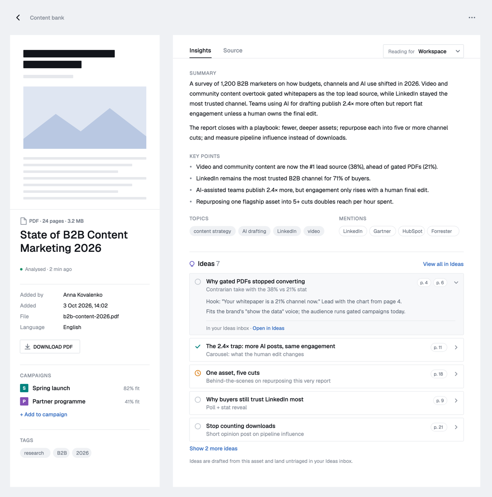
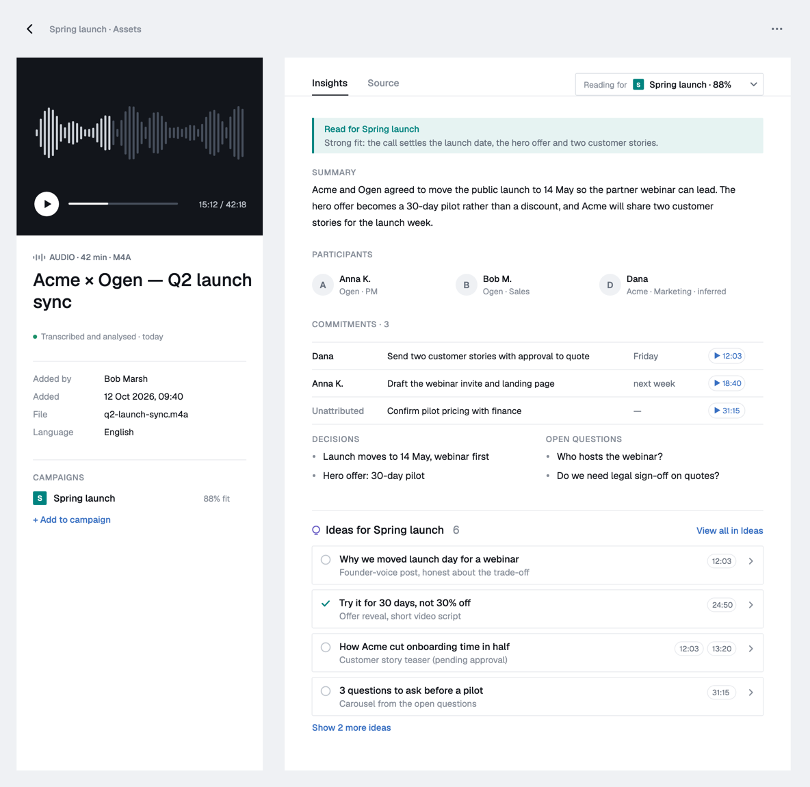
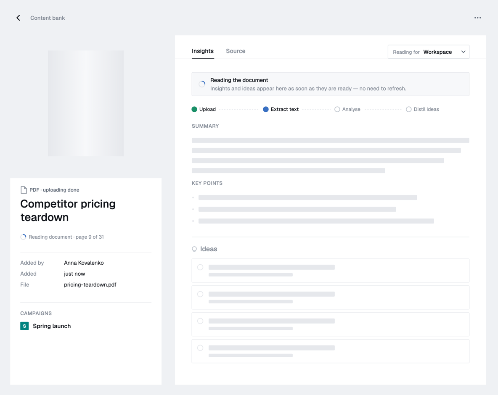
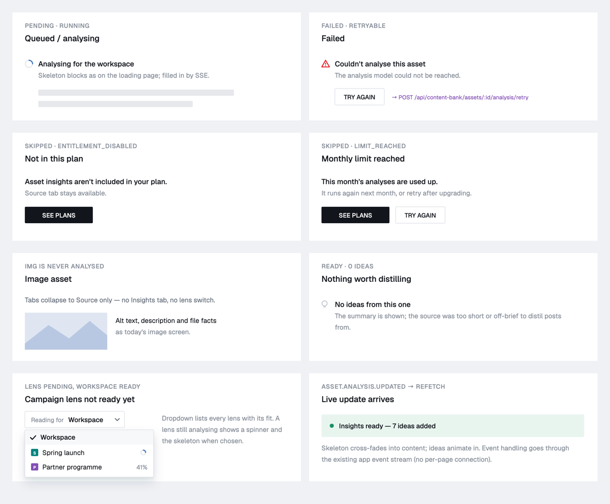
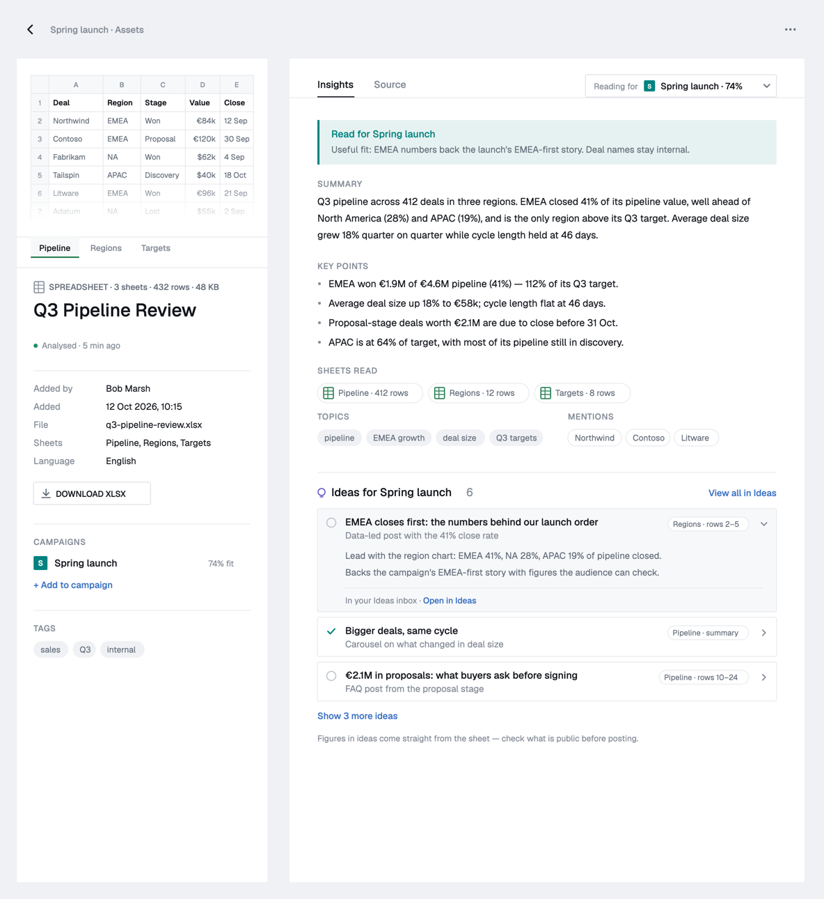
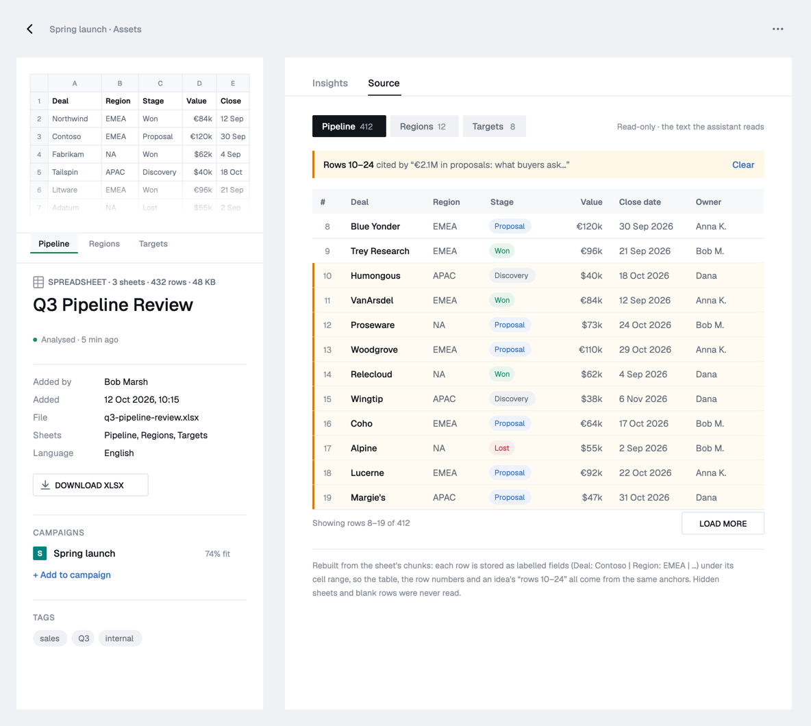
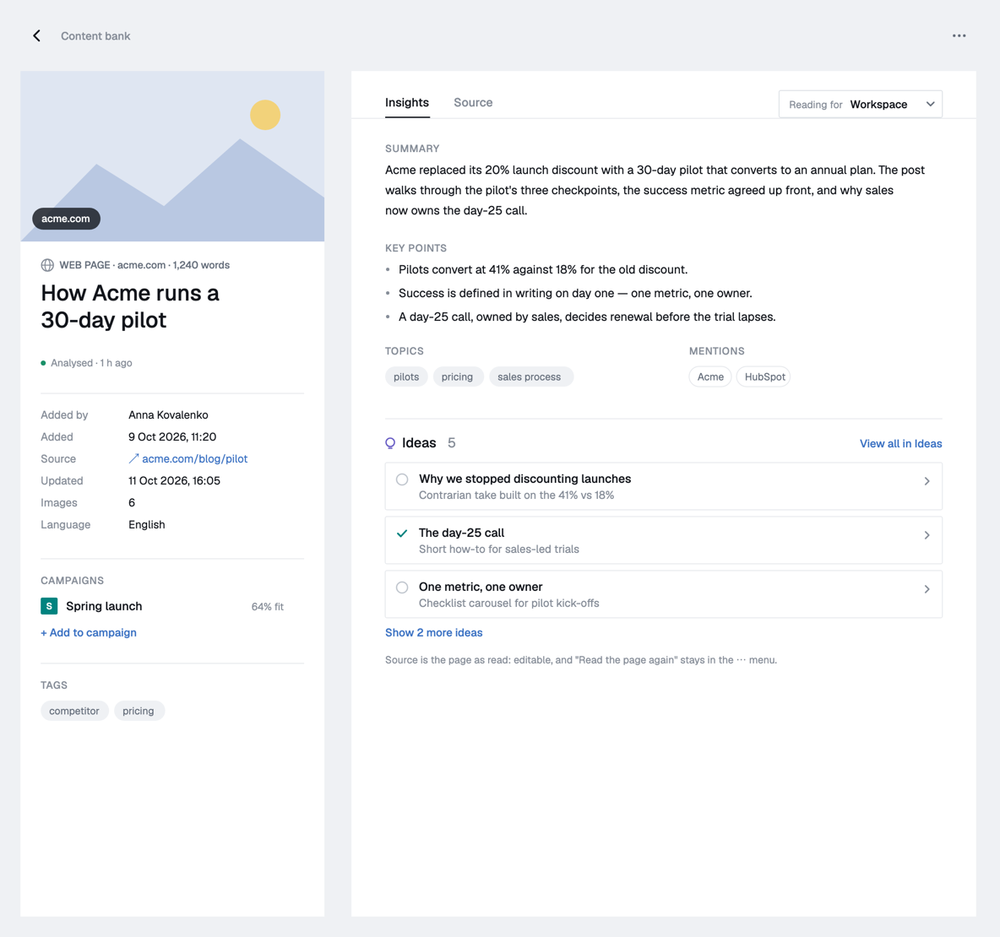
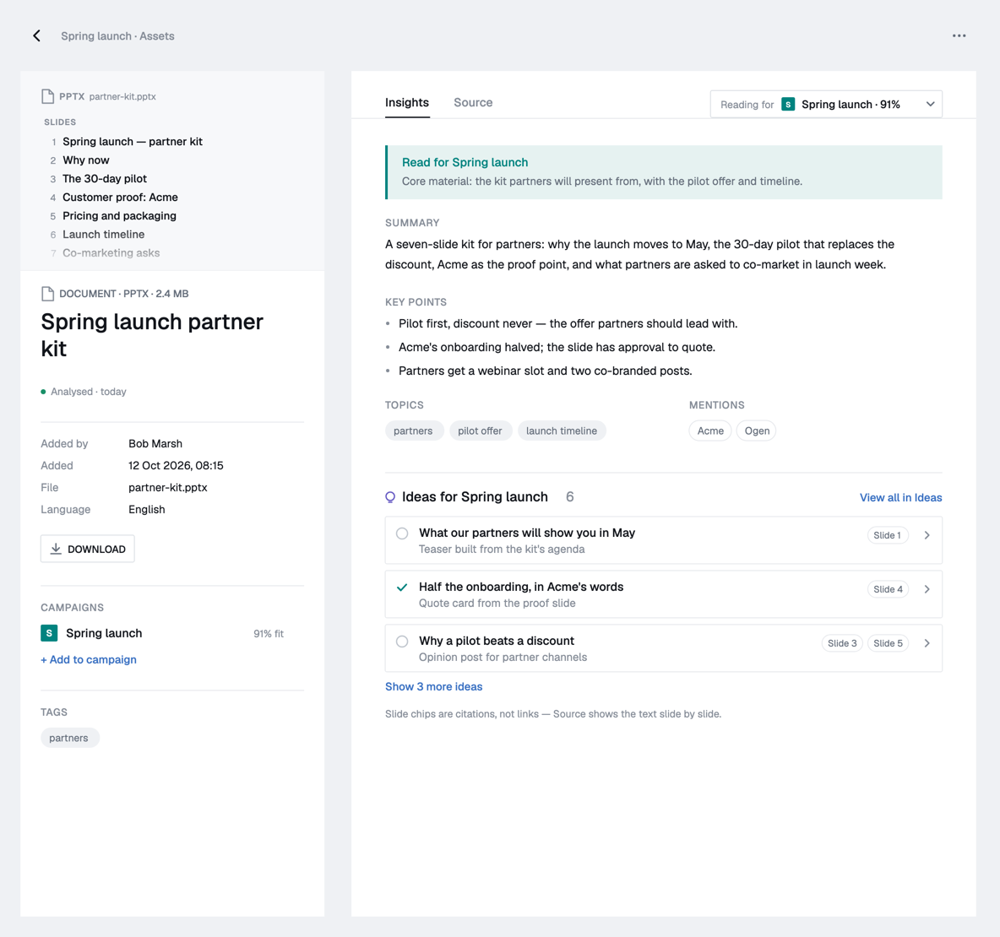
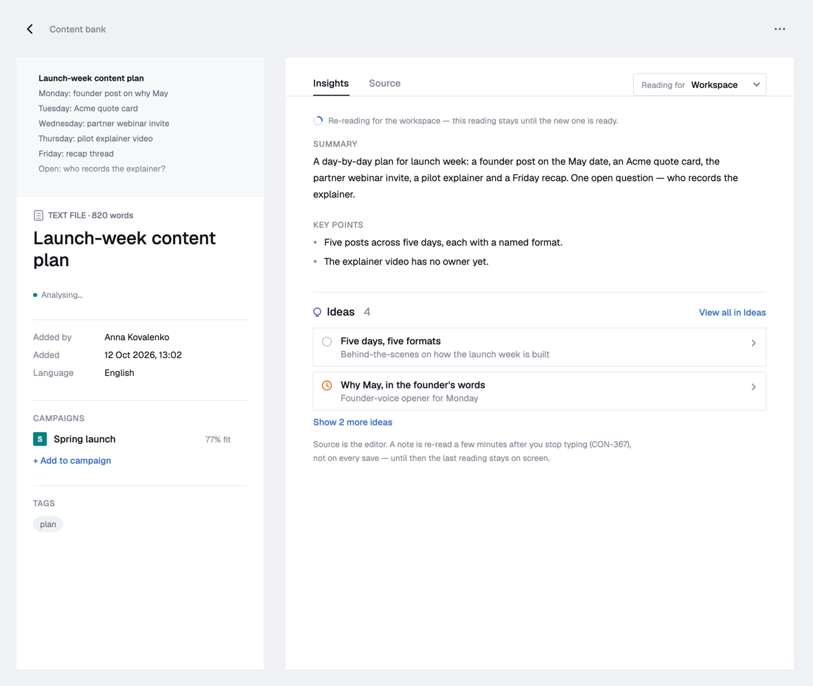
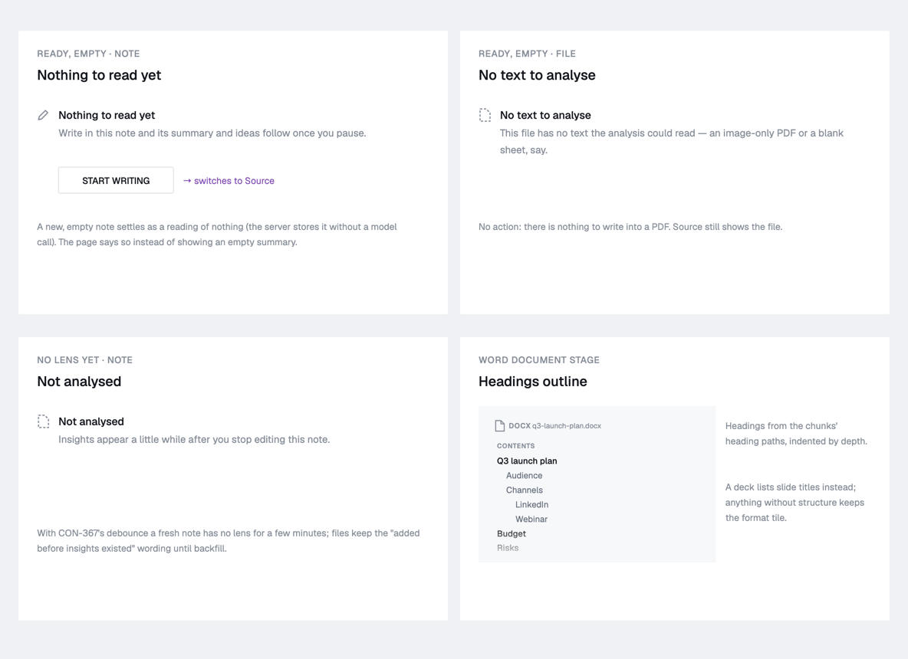

# The asset page — insights and source (CON-366)

Behind the `asset-insights` flag, `/assets/:id` and
`/campaigns/:id/assets/:assetId` are two columns: **what the asset is** on the
left, **what it says** on the right. Flag off, the single-column page is
untouched — `AssetDocument` switches bodies, nothing else.

Code: `components/content/asset-page/`. Rules (pure, tested):
`lib/assetAnalysis.ts`, `lib/sheetChunks.ts`. Data: `hooks/useAssetAnalyses.ts`
over `GET /api/content-bank/assets/:id/analyses` (CON-364).

## Left column

A stage per kind (PDF cover edge to edge, recording player, page hero with its
domain, image, note opening lines, spreadsheet grid, a Word file's headings or a
deck's slide titles, else a format tile), the kind
line, the editable title, a status line, facts (added by, added, file or
source, sheets, language), Download, campaigns with their fit and **Add to
campaign**, tags. Sticky beside the right column on `lg+`; stacked and cropped
below it.

## Right column

**Insights | Source** tabs; the last one used is remembered per browser. An
image has Source only.

- **Lens picker** (a dropdown): the workspace reading and one per campaign,
  with fit, a spinner while one is in flight, and `?lens=` in the address. A
  campaign the asset joined before analysis existed has no row; it is listed
  and answers "not analysed".
- **Insights**: relevance banner (campaign lens), summary (light Markdown),
  key points, meeting notes for a recording (participants, commitments with
  time chips, decisions, open questions), sheets read, topics and mentions,
  then the ideas — five, then "Show N more", each opening in place. No
  triage here; that is the Ideas inbox (and CON-365).
- **States**: reading / analysing (step tracker and skeleton), failed (Try
  again, optimistic), not in plan and monthly limit (See plans), no ideas,
  never analysed, analyses unreadable. A re-read keeps the old reading on
  screen until the new one lands.
- **Source**: today's screens, embedded without their own title — except a
  spreadsheet, which gets a table rebuilt from its row chunks.

## Live updates

`asset.analysis.updated` on `entity:asset:<id>` refetches the asset subtree
and every Ideas list (`lib/eventRouting.ts`, `docs/events.md`). The analyses
poll every 15 s only while something is in flight. A lens that finishes while
the page is open says "Insights ready — N ideas added" for four seconds.

## Shared controls

- One `<audio>` per page (`hooks/useAudioSeek`): the stage's player, driven by
  transcript lines, commitment chips and idea chips. Space plays, arrows step
  five seconds.
- `hooks/useSheetCite`: an idea's "Pipeline · rows 10–24" chip switches to
  Source, picks the sheet, fetches the pages that hold the rows and marks them.

## Spreadsheets

document-service writes per sheet one summary chunk (columns, data-row count,
sample rows) and row groups of `Label: value | …` lines under
`Sheet "X" rows 10-24` with a `cell_range` anchor. `lib/sheetChunks.ts` reads
that back. A row number shows only when it is certain (blank rows are skipped
but counted); a line that will not split is shown whole.

## Wireframes

Illustrative copy; the PRD is CON-366 in Linear.
