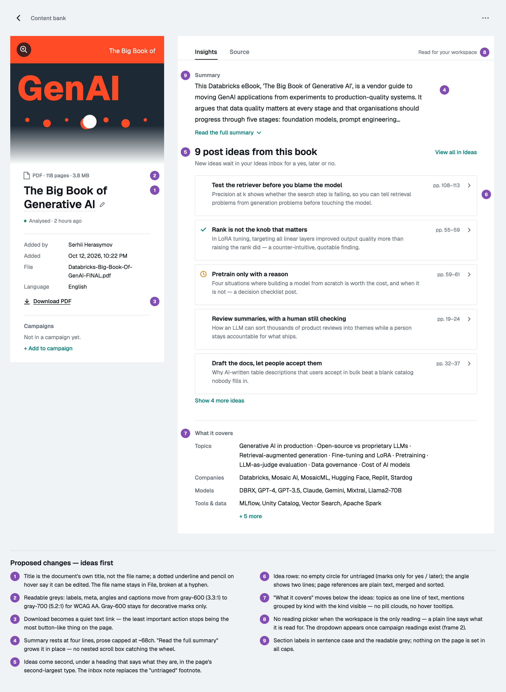
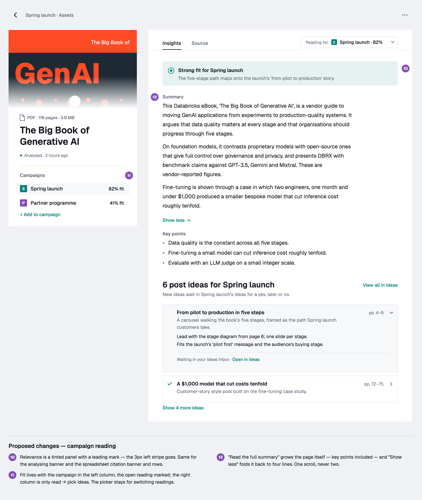
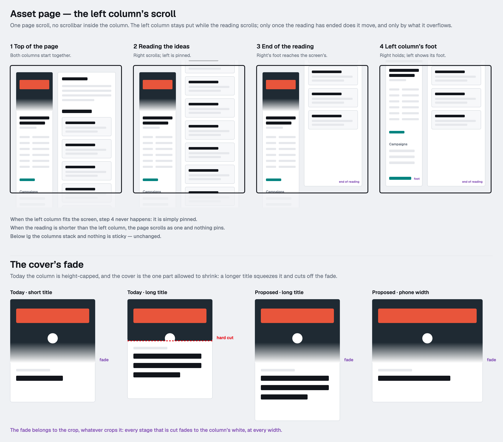
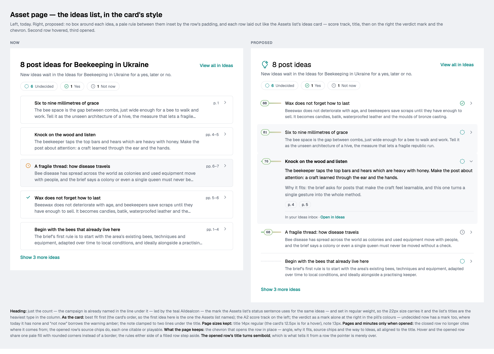
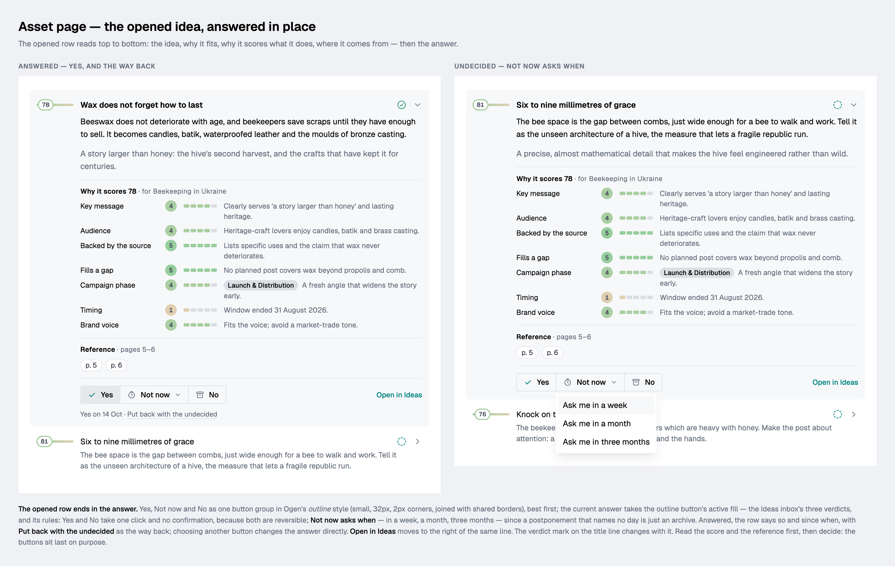
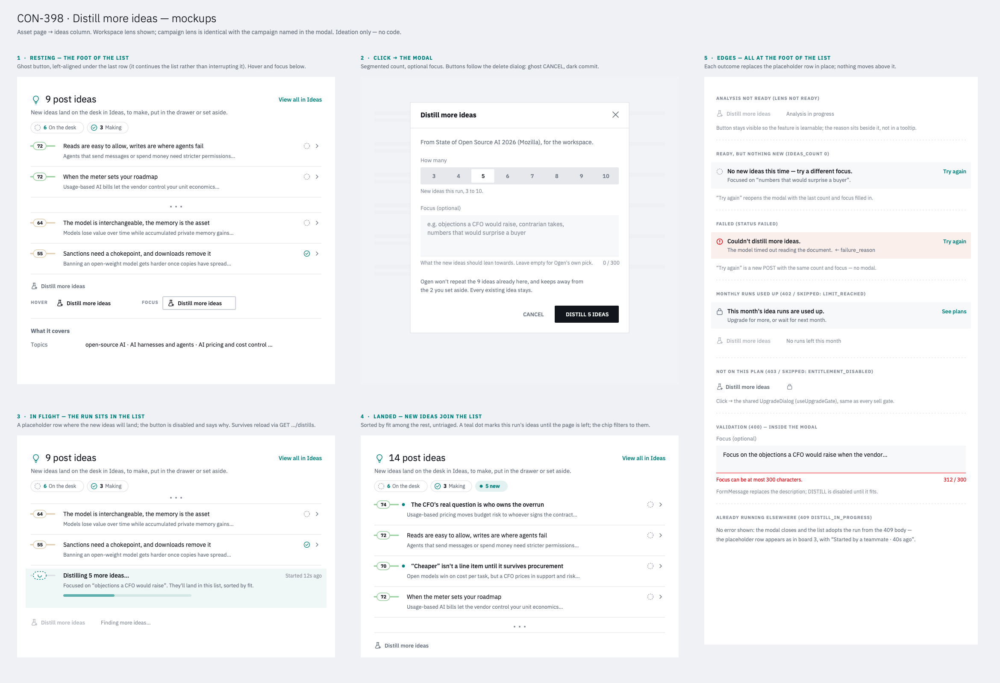

# The asset page — insights and source (CON-366)

`/assets/:id` and `/campaigns/:id/assets/:assetId` are two columns: **what
the asset is** on the left, **what it says** on the right. Shipped unflagged —
the `asset-insights` flag and the single-column page are gone; the old
screens live on as the Source tab, without their own titles.

Code: `components/content/asset-page/`. Rules (pure, tested):
`lib/assetAnalysis.ts`, `lib/sheetChunks.ts`. Data: `hooks/useAssetAnalyses.ts`
over `GET /api/content-bank/assets/:id/analyses` (CON-364).

## Left column

A stage per kind (PDF cover edge to edge, recording player, page hero with its
domain, image, note opening lines, spreadsheet grid, a Word file's headings or a
deck's slide titles, else a format tile), the kind
line, the editable title, a status line, facts (added by, added, file or
source, sheets, language), Download (a quiet link), campaigns with their fit —
the one whose reading is open marked — and **Add to campaign**, tags. A title
that is still a file name (`q3_pipeline_review.xlsx`) shows as words until it
is renamed (`readableTitle`); a dotted rule and a pencil say it is editable. Stacked and cropped below `lg`.

On `lg+` it sits beside the right column with no scroll of its own
(CON-373): pinned while the reading scrolls; a column taller than the screen
waits until the reading's foot reaches the bottom of the screen, then the
reading holds there while the column moves up by what it overflows, until its
own foot shows. `lib/stickyColumns.ts` is the arithmetic (a negative sticky
`top` on the reading, a `min-height` on the row for the extra scroll);
`hooks/useStickyColumns.ts` measures with a `ResizeObserver` and does nothing
on scroll. Tabbing into the column's hidden foot scrolls to the end.

Each stage crops itself and owns its fade, so nothing outside a stage cuts it:
the PDF cover and an image (both open whole on a click) and a page's hero fade
to the column's white at every width; a recording's player has no fade.

## Right column

**Insights | Source** tabs; the last one used is remembered per browser. An
image has Source only.

- **Lens picker** (a dropdown): the workspace reading and one per campaign,
  with fit, a spinner while one is in flight, and `?lens=` in the address. A
  campaign the asset joined before analysis existed has no row; it is listed
  and answers "not analysed". With no campaign at all there is nothing to
  pick, and the picker is a line of text instead.
- **Insights** (ideas first, CON-369): relevance panel (campaign lens), the
  summary at rest — its lead paragraph, four lines — with "Read the full
  summary" growing the page in place (whole summary as light Markdown, key
  points; no box scrolling inside the page), then **N post ideas** (CON-387) — led by the teal `AiIdeaIcon`, the count
  alone in regular weight, the campaign named in the line under it; five, then
  "Show N more", best fit first (`byFit`, the Assets list card's order), each
  row the card's: score track, title, verdict mark in the pill's colours, the
  note in two lines, a pale inset rule between rows and no box. A row opens in
  place, its title semibold, to the angle, the rationale, **Why it scores N**
  (CON-385's `fit_breakdown`: criteria heaviest first, each a Plex Mono
  rating in a disc and five segments in the fit track's colour, the reason
  with the phase or campaign as a chip, a cap said above them), **Reference**
  (the page span, then the source chips — pages merged, `pp. 55–57,
  pp. 57–59` → `pp. 55–59`; closed rows carry no references) and the
  **answer**: Yes / Not now / No as one joined outline button group on the
  inbox's rules — one click and no confirmation for Yes and No, Not now asks
  when — with the record and "Put this back with the undecided" under it.
  **Triage happens here as well as in the Ideas inbox**; an answered row stays
  put until it is closed, even when it leaves the chosen pile. Then meeting
  notes for a recording (participants, commitments with time chips,
  decisions, open questions), then **What it covers**: topics as a line of
  text, mentions grouped by kind with the kind written out, and the sheets
  read. Turning an idea into a post is CON-365.
- **More ideas** (CON-398, unflagged): the ideas end in a ghost
  **Distill more ideas** (`AiChemistry02Icon`). It opens a modal — how many,
  3–10 in a segmented radio group, default 5, and an optional focus of up to
  300 characters, counted as the server counts it (trimmed, in code points) —
  whose commit, **DISTILL N IDEAS**, is the delete dialog's pair with a dark
  fill. The run's news is a row at the foot of the list on the idea rows'
  grid: in flight, nothing new (Try again reopens the form on the last ask),
  failed (Try again re-sends it), out of runs or not on the plan (See plans).
  A run that lands says nothing there — its ideas take their places by fit,
  each with a teal dot, and a **N new** chip beside the piles narrows the list
  to them. Only a run this visit watched reports or marks anything, so last
  week's failure does not greet the next visit. The button stays on screen
  when it can't be pressed, its reason beside it. Runs live under the asset's
  key (`hooks/useIdeaDistill`), so `asset.ideas.distill.updated` moves them
  and their ideas together.
- **Type and colour**: section labels are sentence case; readable grey text is
  `secondary-foreground` (gray-700, 5.2:1 — gray-600 fails AA at 3.3:1), the
  tertiary grey is left to icons and markers. Highlights are tinted panels,
  never a coloured side stripe.
- **States**: reading / analysing (step tracker and skeleton), failed (Try
  again, optimistic), not in plan and monthly limit (See plans), no ideas,
  never analysed, analyses unreadable. A re-read keeps the old reading on
  screen until the new one lands.
- **Source**: today's screens, embedded without their own title — except a
  spreadsheet, which gets a table rebuilt from its row chunks.

## Live updates

`asset.analysis.updated` on `entity:asset:<id>` refetches the asset subtree
and every Ideas list (`lib/eventRouting.ts`, `docs/events.md`). The analyses
poll every 15 s only while something is in flight. A lens that finishes while
the page is open says "Insights ready — N ideas added" for four seconds.
`asset.ideas.distill.updated` (CON-397) takes the same route; the runs poll
every 15 s only while one is in flight, and a poll that finds one settled
refetches the ideas itself.

## Shared controls

- One `<audio>` per page (`hooks/useAudioSeek`): the stage's player, driven by
  transcript lines, commitment chips and idea chips. Space plays, arrows step
  five seconds.
- `hooks/useSheetCite`: an idea's "Pipeline · rows 10–24" chip switches to
  Source, picks the sheet, fetches the pages that hold the rows and marks them.

## Spreadsheets

document-service writes per sheet one summary chunk (columns, data-row count,
sample rows) and row groups of `Label: value | …` lines under
`Sheet "X" rows 10-24` with a `cell_range` anchor. `lib/sheetChunks.ts` reads
that back. A row number shows only when it is certain (blank rows are skipped
but counted); a line that will not split is shown whole.

## Wireframes

The CON-369 design pass (from a design critique):

The left column's scroll and the stages' fades (CON-373):

The ideas list in the Assets list card's style, the fit explained and the idea
answered in place (CON-387):

Illustrative copy; the PRDs are CON-366, CON-369, CON-373 and CON-387 in
Linear.

