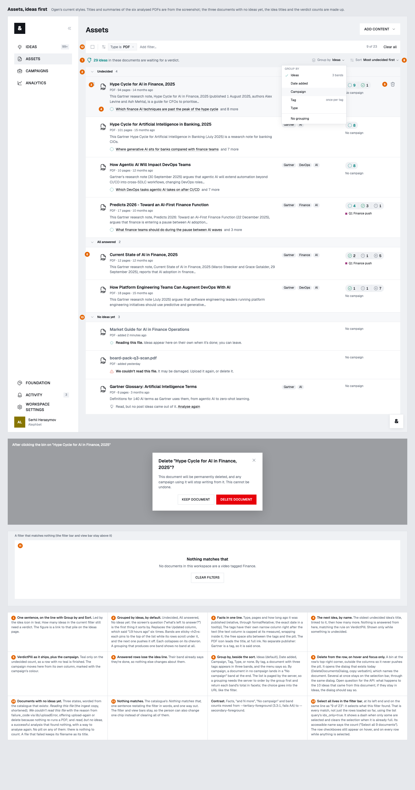
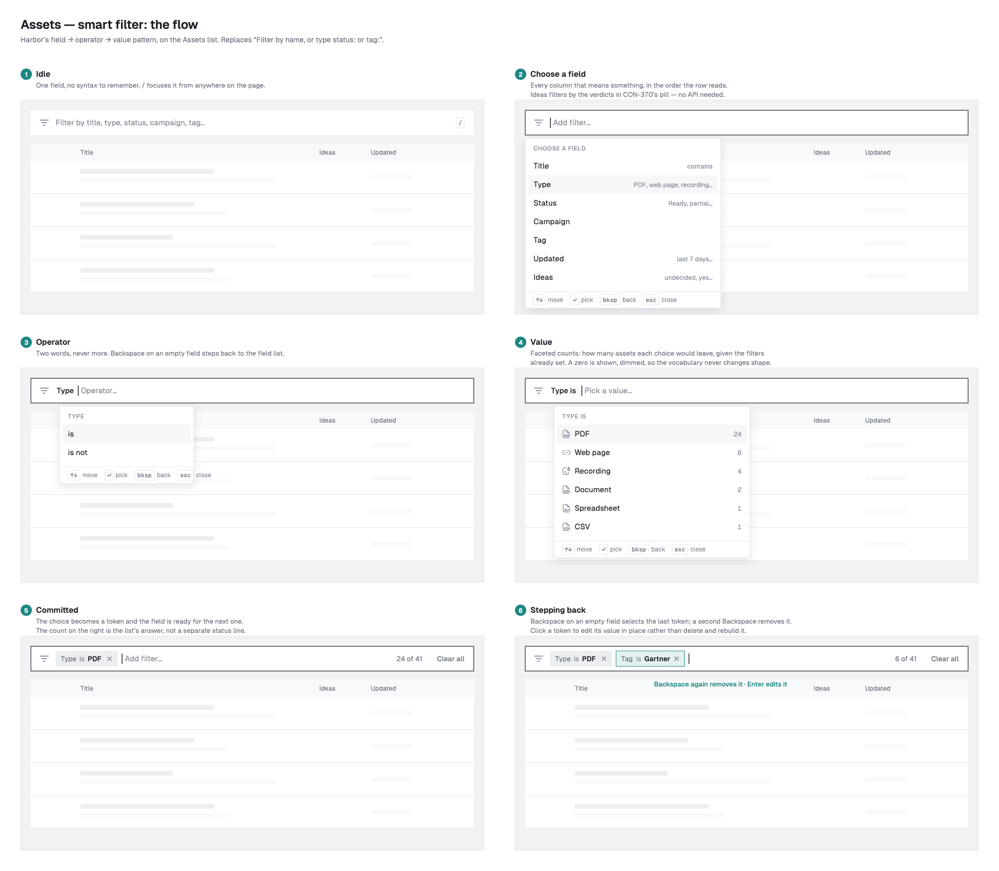
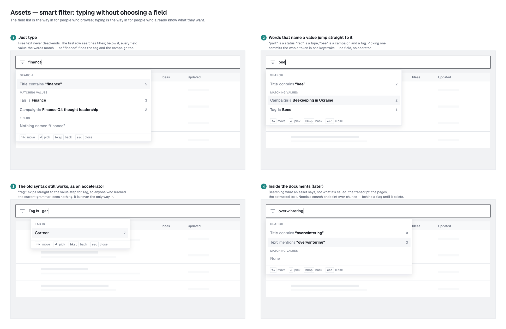
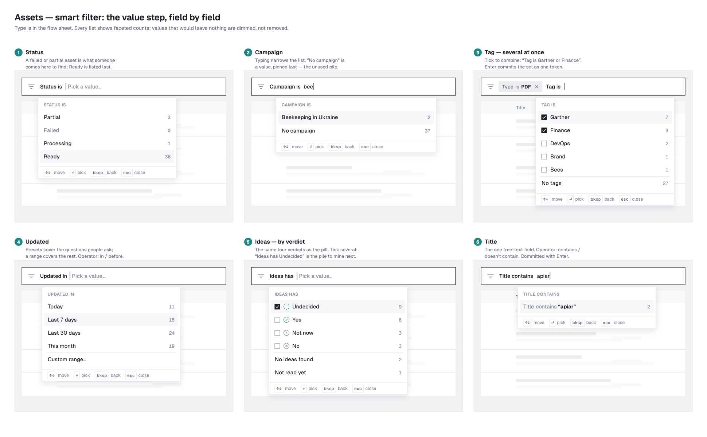
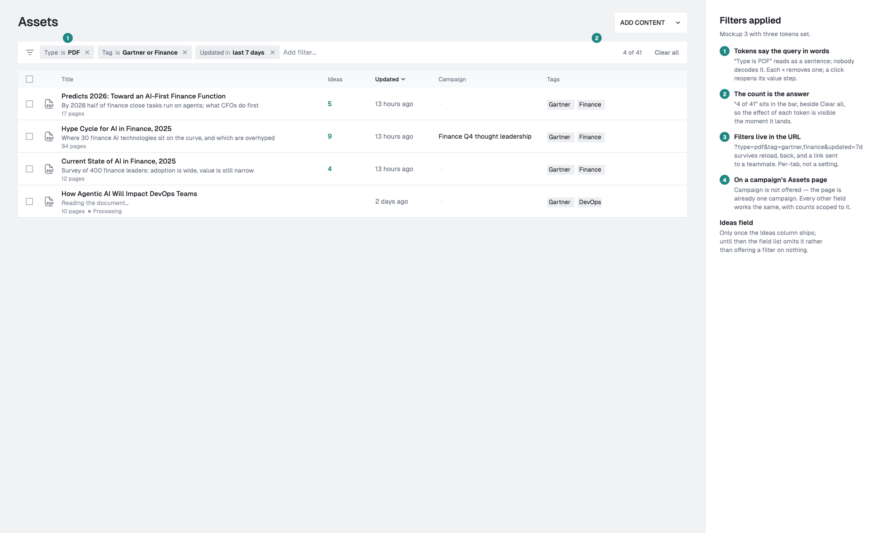
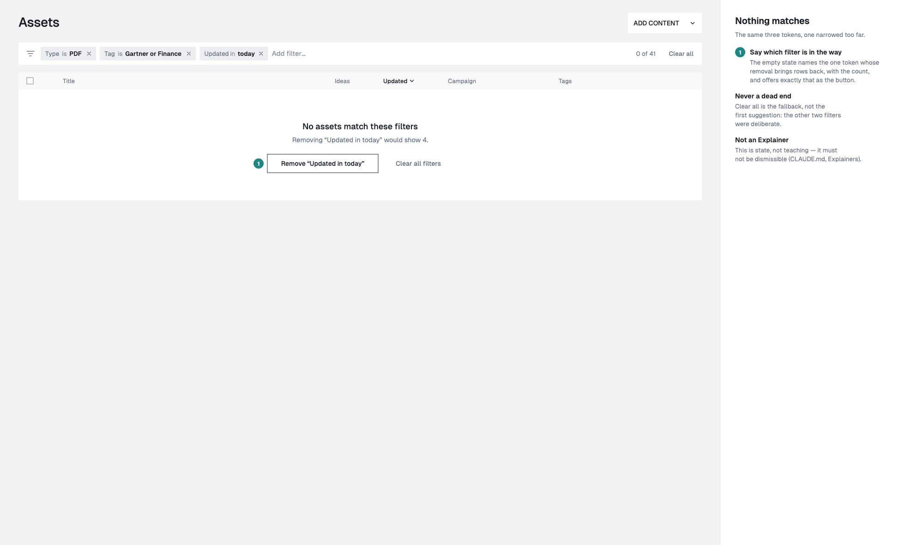

# The Assets list (CON-370, CON-371, CON-378)

`/assets` and `/campaigns/:id/assets` (`ContentList` → `AssetList` →
`AssetListRow`). The list describes what each document *offers* rather than
its storage record, and since CON-378 it leads with the ideas: which
documents still have some waiting, and what the next one is.

## Where the rows come from

Everything on this screen is the server's answer to one query,
`GET /api/content-bank/assets` (CON-374). The client never filters, counts or
sorts a list itself.

- **The URL is the query.** The page's search params use the endpoint's own
  keys (`?kind=pdf&tag=<id>,<id>&ideas=undecided`), parsed by
  `parseAssetListSearch` in `lib/assetFilter`. Two values are kept in words
  rather than instants, so a shared link means the same thing tomorrow:
  - `updated_after=7d` stays a preset;
  - a custom range is two days.
  `toRequestParams` turns both into absolute bounds in the viewer's time zone,
  at request time. The filter is per tab and never goes in `/api/settings`.
- **Paging:** `useAssetList` fetches 50 rows at a time, and the list asks for
  the next cursor as its foot comes into view (an `IntersectionObserver` in
  `AssetList`). The previous rows stay on screen while a new question loads.
- **Not virtualised.** The group bands are `position: sticky` inside the
  list's own scroller, and a virtual window would not mount the band of a run
  that began above it. Rows are fifty to a page, so the DOM stays small.
- **Sorting** is a server parameter, chosen from the Sort menu (there are no
  column headers). Most undecided first is the default (`-ideas_undecided`);
  the others are updated and added, newest or oldest, and title A–Z or Z–A.
  Searching inside the documents adds and defaults to Best match.
- **Grouping** is a server parameter too (`group=`, CON-379); see below.
- **On a campaign's page** the request carries `scope_campaign`. Totals and
  counts are then the campaign's, and Campaign is not offered as a field.
- **The rows are slim:** no `content`. So a note or a page no longer states its
  word count; the full asset stays at `GET /:id`.

## The view bar and grouping

Between the filter bar and the list (`AssetViewBar`):

- **"29 ideas in 6 documents are waiting for a verdict."** The ideas are the
  response's `ideas_undecided_total`, summed by the server over the whole
  match; the documents are `total`, the filtered count or all of them. The
  figure links to Ideas (the campaign's, on a campaign's page). With none
  waiting, the sentence is left out.
- **Which reading counts** is the server's (CON-380): one lens per context,
  the workspace's in the bank and the campaign's on a campaign's page. The
  counts, the next idea, the undecided total, the ideas filter and sort, the
  gist and the analysis status all read it. So on a campaign's page a document
  whose campaign lens hasn't run reads as not analysed, with no pill and no
  summary, even when its workspace lens is ready.
- **Group by:** Date added (the default), Campaign, Tag, Type, or No grouping.
  Not in the URL: it is a per-device preference (`settingsStore.assetGrouping`),
  shared by the bank and every campaign's page, so a reload or a move between
  them keeps it. `none` is ours and never sent. A campaign's own page has no
  Campaign grouping, and falls back to Date added there. The server's `ideas`
  grouping is not offered.
- **Sort:** as above.

The server orders rows by group first, adds `group_key` to each row, and
answers `groups`: every group's key and count over the whole match, in display
order. So a band says how many it holds even when its rows run onto the next
page.

- **Date added** groups are Today, Past week, Past month and Earlier: disjoint
  bands, unlike the `updated` presets.
- **Tag** lists a document once per tag, so the same row can appear under two
  bands, and `groups` counts appearances while `total` counts documents.
- A band is drawn whenever the list is grouped, even for a single group: it is
  what says the list is grouped, and by what.
- Bands are `<h2>`s, sticky, and fold on a click. What is folded is kept per
  device (`settingsStore.collapsedAssetBands`), never in `/api/settings`.

## The filter bar

`smartFilter/AssetFilterBar` is Harbor's field → operator → value bar. Each
choice becomes a token that reads as a sentence: `Type is PDF ×`.

- **Fields:**
  - Title (contains / doesn't contain)
  - Type, Status, Campaign and Tag (is / is not)
  - Updated (in / before; presets or a custom range)
  - Ideas (has / has no)
  - Text (mentions, searched inside the documents)
- **One token per field and operator.** A token can hold several values
  ("Tag is Gartner or Finance"), because the endpoint reads values of one
  field as any-of. Adding to a field edits its token.
- **Counts are the response's `facets`**, which are disjunctive per field. A
  value nothing matches stays in the list, dimmed. Counts show for the
  including operator only.
- **"24 of 41"** (`total` of `total_unfiltered`) and **Clear all** sit at the
  right of the bar.
- **Free text never dead-ends.** It offers:
  - `Title contains "…"` and `Text mentions "…"`, each with a count;
  - then every value whose name matches the words.
  `tag:` and the other old prefixes jump straight to a value step
  (`parseFieldPrefix`).
- **Keyboard:**
  - `/` focuses the bar.
  - ↑↓ move, Enter picks, Space ticks a value without committing.
  - Esc closes.
  - Backspace steps back (value → operator → field). From an empty field it
    selects the last token, and a second Backspace removes it.
- **No results:** `NoMatches` asks the server what removing each token would
  leave. It offers the best removal, with the count, as the primary action.
  This is state, not an `Explainer`.

## Selection

Select all is a checkbox at the filter bar's left end (its `leading` slot),
lined up horizontally with the rows' checkboxes, with as much room on its
right, up to the rule, as on its left. It selects **every match**, not the rows
loaded so far, by asking `ids_only=true` with the same parameters (without
`group`). It shows a dash while some are selected, and clicking it when all
are clears the selection. Bulk tag and bulk delete then act on all N, and the
delete confirmation names N.

- A row's checkbox shows on hover and focus, and on every row once anything
  is selected.
- Changing the filter empties the selection; changing the sort or the
  grouping does not.
- Delete is one request per id (the API has no bulk delete). `useDeleteAssets`
  runs six at a time and refetches once at the end.

## A row

Four columns, three of them fixed: the checkbox; the text, capped at its
measure (`72ch` plus the indent under the icon) so widening the window never
re-wraps it; the tags (168px), right after the text; a spacer that takes the
slack; then the pill and the campaign (200px). Below the `@4xl` container
width the tags fold under the title and the spacer goes.

- **Kind:** a bare 28px Hugeicons mark before the title (`AssetKindMark`),
  from the row's `kind`, in the file type's conventional colour (`--kind-*`
  in `index.css`): PDF red, document blue, spreadsheet and CSV green, slides
  and notes orange, web page dark slate, recording pale teal, anything else
  near-black. The colours tint marks only, never text. An image puts its
  thumbnail there instead. The checkbox is top-aligned with the mark.
- **Title:** an `<h3>`, written as words (`listTitle`): URL-encoding decoded, a
  file's extension dropped, underscores and hyphens read as spaces, and a
  page's " - InfoQ" suffix dropped when the row shows its domain.
- **Facts:** one line, "94 pages · added 2 days ago", then a chip with a clock,
  "published last year", when the source's metadata said when
  (`published_at`). They are two facts, so both show (`rowDates`), each with
  its exact date as the tooltip. No kind word: the mark already says it. A
  page names its domain, a recording its duration; a partial read adds its
  status.
- **Summary:** the analysis gist, two lines at most; during a Text mentions
  search, where it matched instead (`MatchSnippet`).
- **The idea line** (`rowState`):
  - With ideas waiting: the next one by name (`next_idea`, the oldest
    undecided, chosen by the server), opening the asset on its undecided pile,
    then "and N more". Hovering or focusing it opens a light card to its right,
    lifted by a shadow, listing the asset's other ideas' titles with a pale
    rule between them. They come from the same
    reading as the counts (the workspace's lens in the bank, the campaign's on
    a campaign's page), read from `GET /:id/analyses` only on first hover.
  - Reading: "Reading this file." with a spinning icon while ingest or
    analysis runs. No pill and no summary yet.
  - Failed: "We couldn't read this file." with the reason worded from
    `failure_code` (`ingestFailureMessage`), then "Upload it again, or delete
    it." Nothing re-runs a PDF, so there is no retry.
  - Read with no ideas: "Read, but no post ideas came out of it." with
    Analyse again (`POST …/analysis/retry`).
  - Never analysed, or the analysis failed or was skipped: nothing, rather
    than a claim of "no ideas".
- **Tags:** rounded chips in their own column.
- **Ideas:** the verdict pill (`VerdictPill`), at 1.2× its first size.
  - One segment per verdict, icon and count, always in the order Undecided ·
    Yes · Not now · No. Verdicts with no ideas are left out. Undecided is the
    only teal, so a row with no teal is finished.
  - The tooltip, which is also the pill's accessible name, spells the counts
    out. A segment opens the asset page on that pile (`?verdict=`).
- **Campaign:** under the pill, each with its `CampaignMark`. On a campaign's
  own list only the others are named. "No campaign" is said only in the bank,
  and only once the campaigns have loaded.
- **Bin:** an 18px `Delete02Icon`, no box, at the row's top-right on the
  checkbox's line. It shows on hover or focus only, and on touch screens, and
  goes through `DeleteDocumentsDialog`. The bin and the checkbox fade in
  (opacity, ease-out, 200ms; none with reduced motion).

## The asset page's piles

Above the ideas, the asset page shows the same verdicts with their words as filters (`AssetIdeaList`), driven by `?verdict=`. Choosing "No" is the one way to see the answered-no ideas again. Choosing the active pile again clears the filter.

## Wireframes

### Ideas first (CON-378)

The wireframe CON-378 was built from, with illustrative data. Its numbered
notes are the decisions above.

### The smart filter (CON-371)

