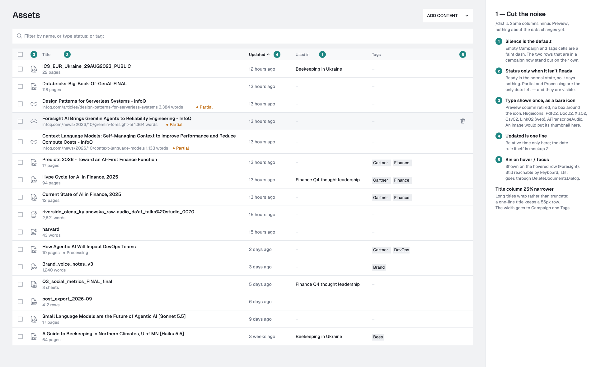
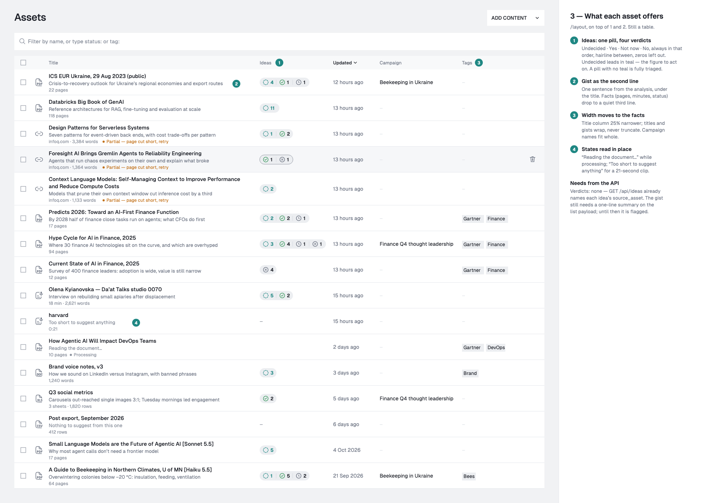
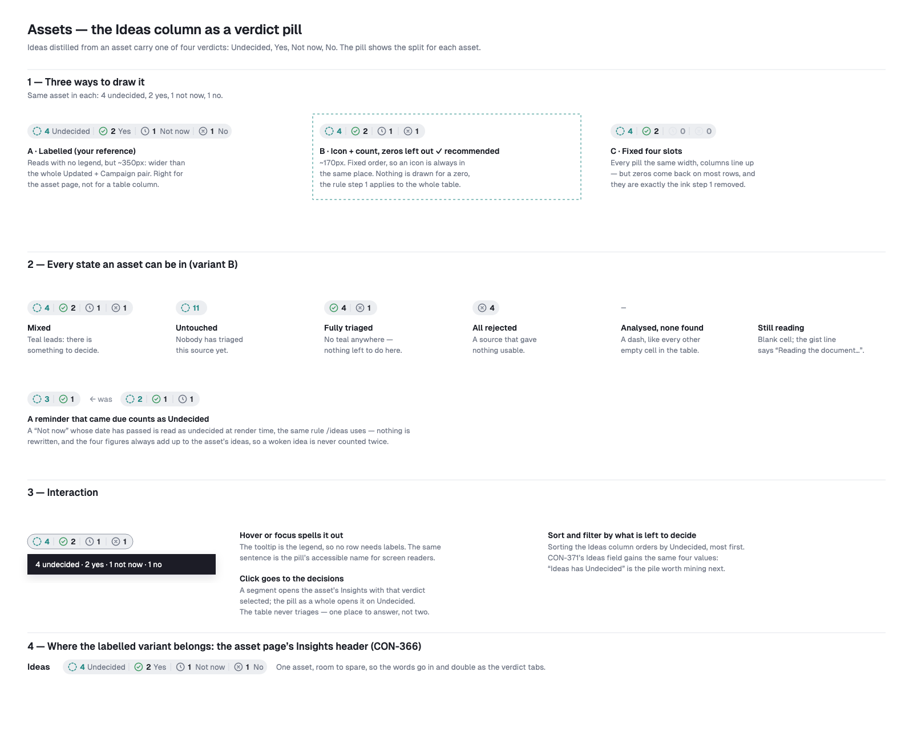
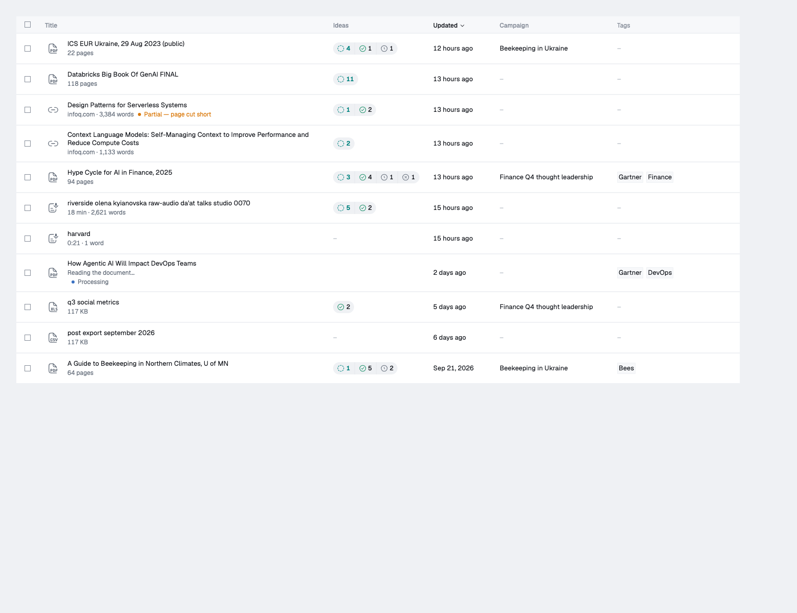

# The Assets list (CON-370, CON-371)

`/assets` and `/campaigns/:id/assets` (`ContentList` → `tables/docsTable`).
The list describes what each document *offers* rather than its storage record.

## Where the rows come from

Everything on this screen is the server's answer to one query,
`GET /api/content-bank/assets` (CON-374). The client never filters, counts or
sorts a list itself.

- **The URL is the query.** The page's search params use the endpoint's own
  keys (`?kind=pdf&tag=<id>,<id>&ideas=undecided`), parsed by
  `parseAssetListSearch` in `lib/assetFilter`. Two values are kept in words
  rather than instants, so a shared link means the same thing tomorrow:
  - `updated_after=7d` stays a preset;
  - a custom range is two days.
  `toRequestParams` turns both into absolute bounds in the viewer's time zone,
  at request time. The filter is per tab and never goes in `/api/settings`.
- **Paging:** `useAssetList` fetches 50 rows at a time, and the table asks for
  the next cursor as its end comes into view (`VirtualTable`'s
  `onEndReached`). The previous rows stay on screen while a new question
  loads.
- **Sorting** is a server parameter. A header click asks for another order and
  the table draws rows as they came (`manualSorting`). The options are
  Updated, Title, and Ideas (most undecided first). Searching inside the
  documents sorts by relevance.
- **On a campaign's page** the request carries `scope_campaign`. Totals and
  counts are then the campaign's, and Campaign is not offered as a field.
- **The rows are slim:** no `content`. So a note or a page no longer states its
  word count; the full asset stays at `GET /:id`.

## The filter bar

`smartFilter/AssetFilterBar` is Harbor's field → operator → value bar. Each
choice becomes a token that reads as a sentence: `Type is PDF ×`.

- **Fields:**
  - Title (contains / doesn't contain)
  - Type, Status, Campaign and Tag (is / is not)
  - Updated (in / before; presets or a custom range)
  - Ideas (has / has no)
  - Text (mentions, searched inside the documents)
- **One token per field and operator.** A token can hold several values
  ("Tag is Gartner or Finance"), because the endpoint reads values of one
  field as any-of. Adding to a field edits its token.
- **Counts are the response's `facets`**, which are disjunctive per field. A
  value nothing matches stays in the list, dimmed. Counts show for the
  including operator only.
- **"24 of 41"** (`total` of `total_unfiltered`) and **Clear all** sit at the
  right of the bar.
- **Free text never dead-ends.** It offers:
  - `Title contains "…"` and `Text mentions "…"`, each with a count;
  - then every value whose name matches the words.
  `tag:` and the other old prefixes jump straight to a value step
  (`parseFieldPrefix`).
- **Keyboard:**
  - `/` focuses the bar.
  - ↑↓ move, Enter picks, Space ticks a value without committing.
  - Esc closes.
  - Backspace steps back (value → operator → field). From an empty field it
    selects the last token, and a second Backspace removes it.
- **No results:** `NoMatches` asks the server what removing each token would
  leave. It offers the best removal, with the count, as the primary action.
  This is state, not an `Explainer`.

## Selection

The header checkbox ticks the loaded rows. Once they are all ticked and the
match is larger, the selection bar offers *Select all N matching*, which
resolves with `ids_only=true` and the same parameters. Bulk tag and bulk
delete then act on all N, and the delete confirmation names N.

- Changing the filter empties the selection; changing the sort does not.
- Delete is one request per id (the API has no bulk delete). `useDeleteAssets`
  runs six at a time and refetches once at the end.

## A row

- **Kind:** a bare Hugeicons mark with no box (`AssetKindMark`), from the row's `kind`. The server owns that classification.
  - PDF, document, spreadsheet, CSV, presentation, web page, recording, note.
  - An image puts its thumbnail in the slot instead.
- **Title:** written as words (`listTitle`).
  - URL-encoding is decoded, a file's extension dropped, and underscores become spaces.
  - A hyphenated file name reads as words.
  - A page's " - InfoQ" suffix goes when the row shows its domain.
  - Titles wrap and never truncate, so the table measures each row (`VirtualTable`'s `measureRows`).
- **Second line**, when there is one:
  - While a Text mentions search is active: where it matched, with the words marked (`MatchSnippet`).
  - "Reading the document…" while ingest or analysis runs.
  - Otherwise the analysis gist (`gist`).
- **Facts:** a quiet line with:
  - the domain;
  - a recording's duration (`file.duration_ms`);
  - a file's pages;
  - a status only when it isn't Ready ("Partial — page cut short").
- **Ideas:** the verdict pill (`VerdictPill`).
  - One segment per verdict, icon and count, always in the order Undecided · Yes · Not now · No.
  - Verdicts with no ideas are left out. Undecided is the only teal.
  - The tooltip, which is also the pill's accessible name, spells the counts out.
  - A segment opens the asset page on that pile (`?verdict=`).
  - Counts are the row's `idea_counts`. The server applies the rule that a due "Not now" counts as Undecided.
  - Sorting the column orders by Undecided, most first (`sort=-ideas_undecided`).
- **Updated:** one line through `lib/intl`.
  - A distance within the week, then a date with a four-digit year.
  - The exact time is in the tooltip.
- **Campaign:** the campaigns holding the document (`campaign_ids`, named through `useCampaignNames`). On a campaign's own list the column is "Also in" and names the others. Post usage is not shown here.
- **Tags:** shown as pills.
- **Empty cells:** a faint dash, with "None" for a screen reader.
- **Bin:** shows on hover or focus only, and on touch screens. It still goes through `DeleteDocumentsDialog`.

## The asset page's piles

Above the ideas, the asset page shows the same verdicts with their words as filters (`AssetIdeaList`), driven by `?verdict=`. Choosing "No" is the one way to see the answered-no ideas again. Choosing the active pile again clears the filter.

## Wireframes

As built, with illustrative data:

